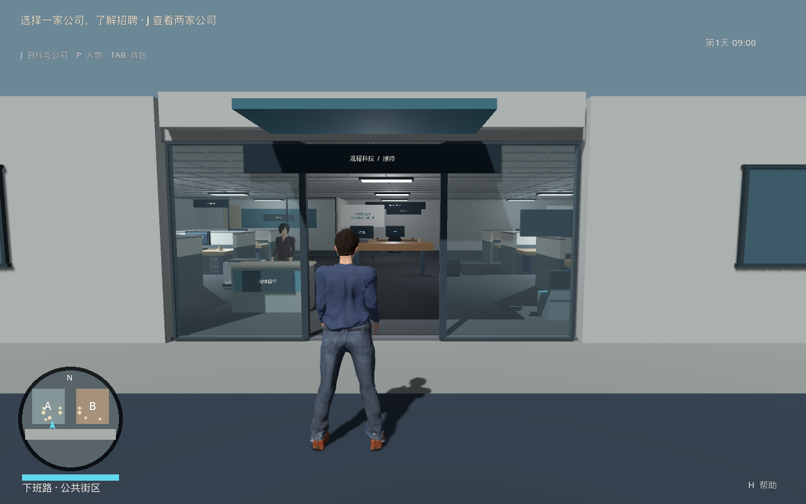
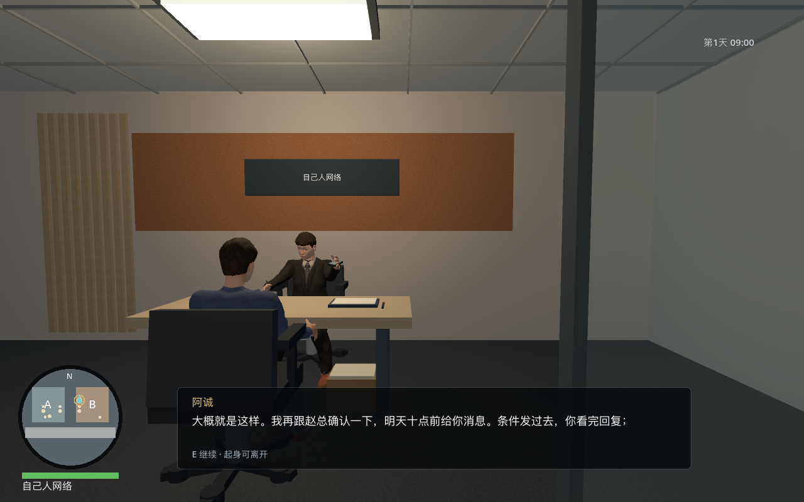
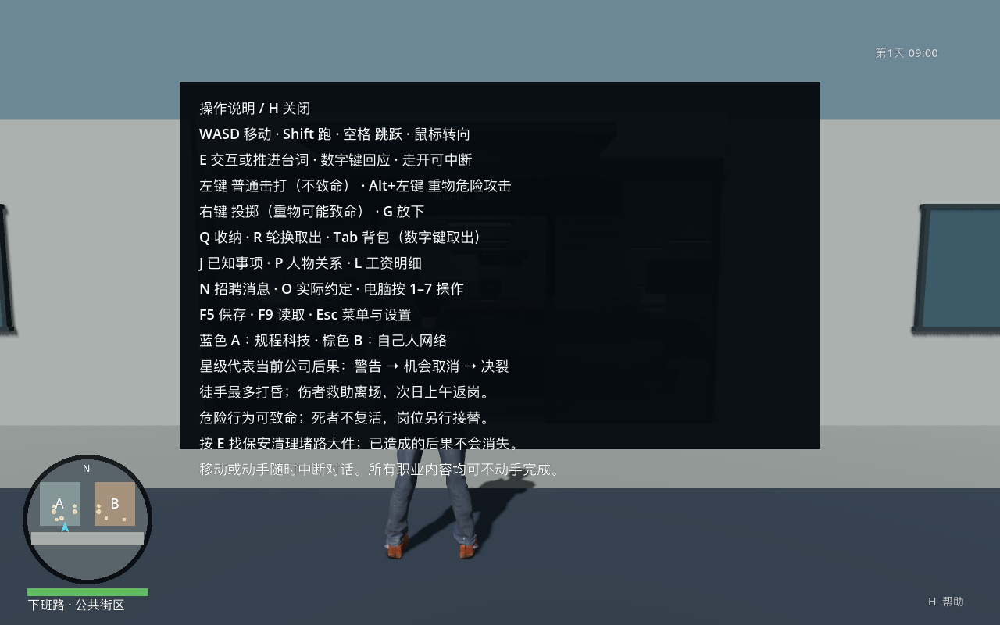

# 《今天不上班》GTA VI 品质差距全面审查

日期：2026-09-29（Asia/Shanghai）

源码基线：`main / 3113a91`；引擎实测 `Godot 4.7.1.stable.official.a13da4feb`。

范围：现有 UI、场景、人物、动作、玩法、叙事、声音、世界模拟、性能、生产和交付。**这是审查交付，不是整改完成记录。**

配套：[完整品质开发纲要](2026-09-29_GTA6级品质开发纲要与实施路线.md) · [本轮证据与复现](evidence/2026-09-29-audit/README.md)

## 1. 判断先说清楚

**当前项目是有较完整职业状态链的第三人称功能原型，距离用户要求的 GTA VI 展示水准，还有制作层级的差距。** 它可以记录应聘、入职、交付、冲突与工资，却没有持续把这些状态转化为可信的人、场所、动作和生活。大量时候，玩家仍然是在灰盒环境中操作文本流程。

这不是“再增加一些道具、再缩小字幕、再通过几项测试”就能解决的距离。角色资产、动作系统、场景制作、交互界面、声音、世界活动和制作工具都需要建立正式品质标准。现有逻辑有保留价值，但它不能充当最终画面和玩家体验的验收依据。

用户本轮明确选择：

- **目标是 GTA VI 官方展示中的高密度写实世界。** 不再以 GTA V 或一般独立游戏原型的标准代替。
- **先按完整品质目标规划，预算后定。** 小片段用于证明制作能力，不能被包装成最终目标已经降低。
- 本轮请求是扫描、批判和开发文档；没有启动游戏代码改造、引擎迁移、付费采购或发布。

### 必须纠正的制作方式

1. **“有”不等于“像”。** 有骨骼、材质、圆地图和面试动作，只能证明功能存在。人物的目光、手指接触、衣料、说话停顿、环境响应才决定可信度。
2. **完成标准太偏向状态。** 测试确认“手机显示在手上”，仍允许看起来像抓不住手机；测试确认“已完成交付”，仍不能证明交付过程有现场张力。
3. **品质被不断后置。** 写实资产、自然动画、表情、环境声和真实玩家验收长期开放。它们正是用户要的核心，不应在最终目标中继续作为可有可无的尾项。
4. **补丁在局部累计，整体未立样板。** 修一个字幕、加一个音效、补一个分支会改善症状；没有被认可的完整连续片段，后续内容仍会复制同样的原型质感。

## 2. 证据与边界

### 本轮实际做了什么

| 类型 | 实际范围 | 能证明什么 | 不能证明什么 |
| --- | --- | --- | --- |
| 当前源码静态核查 | `project.godot`；场景入口；UI、玩家、NPC、人物动画、环境生成、面试、工作、社交、工资、存档、寻路及打包相关文件 | 具体实现机制、资源组成与缺失的接入环节 | 所有分支都无缺陷、所有设备表现一致 |
| 当前源码图形取证 | 17 张 1280×800 原始截图：街道/入口/工位/A 面试、B 面试与动作、街道反向、10 个页面 | 当前画面与 UI 布局；功能与场景的分离 | 连续自由游玩的整体质量、所有长期页面溢出 |
| 实际 GUI 操作 | 隔离 B 预览：候场提示→E→1 落座；J 页面、鼠标点条目、H 帮助与关闭 | 正常面试入口能进入；当前页面输入方式；帮助页底部溢出 | 从新档自主走完全职业线；完整 B 面试自然阅读时长 |
| 已有隔离检查 | `panels_test`、`interview_performance_test`、`work_projects_test`、`full_route_test` | 相关逻辑基线，结果见第 7 节 | 动作自然、工作有趣、用户满意 |
| 图形性能短测 | M5 Pro / macOS / Compatibility / 1280×800；正常及混乱各 600 帧 | 该次固定场景采样 | GPU 瓶颈归因、稳定最低配置、长时间开放世界性能 |
| 历史复核 | 9 月 22—23 日体验、验收、经验与进度 | 已修症状与未通过体验的连续性 | 把旧截图当成本次新测 |

未执行：陌生玩家盲测、听音混音评审、完整战斗手感实测、多屏幕适配、手柄、跨硬件、长期游玩与存档压力、最终美术样板。未重跑 43 项全套回归；仓库中的 43 个测试文件及历史通过记录不冒充本轮执行结果。

官方参考：已核查 [GTA VI 官方截图目录](https://www.rockstargames.com/VI/media/screenshots)与 [Rockstar Trailer 2 说明](https://www.youtube.com/watch?v=VQRLujxTm3c)。官方说明该片混合实机游玩和过场。本轮官网目录可读取，但大图 CDN 请求失败，浏览器大图空白；**没有完成官方原图的逐帧、同曝光对比**。因此本报告不声称已精确测出“与 GTA VI 差多少百分比”，更不从宣传画面推断其全部 AI、物理和玩法。

## 3. 最直观的画面证据

### 当前正常入口

门框、招牌和接待已存在，但立面是巨大平板，人物与环境的细节层级不一致，入口缺少自然生活痕迹。没有 UI 时，它更像用于验证人物走动的办公室样板，尚不能靠建筑、材质和活动表达“真实城市中的一家公司”。

### 当前 B 面试动作

手机动作确实发生了，不能再批评成“只有文字”。问题变成：手指姿态、目光和物体接触粗糙，脸部缺少可辨识表演，人物在画面中的占比小，前景椅背和大片空墙占据注意力；字幕继续承担大部分情绪与情境。

### 当前帮助页

最后一行文字落在深色底板之外。这个问题在默认分辨率就能看到，不需要用极端窗口尺寸才能触发。

其他画面： [入口内侧](evidence/2026-09-29-audit/office.png)、[工位](evidence/2026-09-29-audit/work.png)、[A 面试](evidence/2026-09-29-audit/interview.png)、[街道反向](evidence/2026-09-29-audit/street-reverse.png)、[工作台 UI](evidence/2026-09-29-audit/ui-computer.png)、[人物页](evidence/2026-09-29-audit/ui-people.png)、[招聘消息](evidence/2026-09-29-audit/ui-messages.png)。

注意：工作台图由夹具直接打开页面，背景仍在街上，只用于评价页面本身，不登记为游戏允许在街上办公的缺陷；反向街景残留夹具提示，不据此推断正式流程错乱。

## 4. 问题总表

P0：阻断本轮目标品质或后续可靠生产，**不一定表示崩溃**。P1：主要体验或技术缺口。P2：局部可用性/一致性问题。G0—G8 对应开发纲要中的关卡。旧编号沿用，新增从 R28 起。

“已确认”指现象或实现已经核实；方案全部尚未实施。“推断”指实现可能导致的体验后果，需要定向动态测试。风险分别列明留置风险与修改风险。

| ID / 优先级 | 问题与证据 | 当前行为（修改前） | 拟议方案 | 预期行为 | 风险 | 状态 |
| --- | --- | --- | --- | --- | --- | --- |
| R13 / P0 | `hud.gd` 将消息、人物、约定、工作、历史均画成大文本面板；10 页截图可核查；开局仍靠顶部句子和 J | 玩家频繁离开世界阅读快捷键和规则；不同事情触感相近 | G2 重建信息层级；按情境出现简短提示，手机/证据/实体终端各有适合的交互 | 玩家看人、物和环境即可理解多数下一步；详细记录可追溯 | 留置：阅读器感持续；改动：过度隐藏会让自由探索失去线索 | 图形/源码确认；首次玩家负担待量测 |
| R14 / P1 | A/B 默认坐姿镜头均留大片天花/墙；椅背在前景，人物脸小；`player.gd` 主要以站/坐两种镜距处理场景 | 能看到双方，难看清眼神和细节；镜头缺少针对空间的构图目标 | G1/G2 做肩位、目标可见性、障碍与退让规则；按场景设置但保留自由镜头 | 正常角度可读对方动作，转头、起身、靠墙不突兀 | 留置：精细资产也看不到；改动：自动纠正过强会夺走控制 | 构图确认；未宣称旧“头低至桌面”仍存在 |
| R16 / P0 | 10 位初始 NPC 复用 3 套 GLB；`human_visual.gd` 生成通用曲线，未见表情/唇形接入；现帧面孔和姿态重复 | 职业主要通过名字、服装颜色和选项区分 | G1 建立正式主角与关键人物、面部绑定、表演素材、视线、动作过渡与个性 | 不读姓名也能识别人；沉默和拒绝也能通过表演读懂 | 留置：人物像任务终端；改动：新骨架可能破坏座位、握持与旧资源挂点 | 资产/源码/画面确认；品质开放 |
| R26 / P1 | B 手机已随腕骨；动作回归只要求手腕距箱中心 <0.60m；关键帧可见抓握粗糙 | 道具和手“接近”即可通过，缺手掌/手指接触证明 | G1 对纸、手机、箱分别定义接触点和接触区间，动画匹配与 IK 修正 | 物体被托住、拿起、推离有连续支撑；中断后所有权一致 | 留置：悬浮/虚抓破坏可信；改动：强制 IK 可扭曲肘腕 | 同步功能已修；精细接触未通过 |
| R20 / P0 | `neighborhood.gd` 两家公司共用布局循环；`office_dress.gd` 共用工位和 6 栋远景盒楼；当前内外截图 | 小块平地、复制家具与空白立面；A/B 主要区别是招牌、色温 | G1 制作样板；G4/G5 做模块化街道、真实建筑层次、使用痕迹、视线和活动点 | 材质、布局、使用痕迹表达公司文化；前中远景都有可信信息 | 留置：扩图只扩大粗糙；改动：细节会增加遮挡、灯光和内存成本 | 当前画面确认；写实资产尚未制作 |
| R17 / P1 | B 实际 E→1 能落座；现内容有条件追问、约定和后续回应；但现场仍由 E/数字键分段文字推动 | 面试流程完整，互动节奏仍像逐页问答 | G3 把关键分歧落实为视线、资料、停顿、现场选择与后续行为；保留 A 三轮/B 一轮 | 玩家记得一次遭遇和人物态度，而不只记得按过选项 | 留置：职业线被当成解锁链；改动：过场化会损害随时离开的自由 | 功能存在已确认；本轮未完整自然读完四轮 |
| R18 / P0 | `work_projects.gd` A 为资料+两项切换+预览，B 类似；UI 是全屏暂停页；旧“三秒自动成功”已被替换 | 有判断与纠错，但主要深度停在阅读正确材料和选择正确值 | G3 让原话、证据、同事在场、展示对象、拒绝/捷径改变现场；不扩成独立办公小游戏 | 同一个问题有多种有效处理，后果能在世界中看到 | 留置：核心仍像答题；改动：不能用更多表单或强制跑腿充深度 | 当前机制确认；趣味与节奏未验收 |
| R19 / P1 | 时钟 1 秒=0.5 游戏分钟；交谈×0.2，页面全停；日夜只改太阳角度/亮度与环境色，3 位角色有固定下班点 | 时间能推进，但生活变化和光照变化粒度少 | G4 做时段场景、营业/通勤/照明与天气过渡；重要等待可主动跳过 | 早晚能从活动和声音分辨；阅读辅助不惩罚玩家 | 留置：钟走而世界像静物；改动：日程容易使任务目标错过或失联 | 代码确认；未本轮重测全天，不重报“凌晨如白昼” |
| R25 / P1 | `SocialLife.PROFILES` 固定近况句；茶/午饭/同行复用；`people_listen` 与 `people_boundary` 共用结算 | 关系有记忆，但不同态度常回到同一句感谢，重复相处缺内容变化 | G3/G5 用共同事件、立场冲突、帮助方式和事后主动行为写差异 | 信任改变行动和交流方式；拒绝不等于必须刷好感 | 留置：人物个性停在简介；改动：分支成本，不能加入强制每日关系维护 | 源码确认；未完整重玩三类活动 |
| R27 / P0 | 只有撞击合成声与 4 个面试音源；未见脚步材质、持续室内外底噪、对白语音/混音分层；叫号/回座/离场已存在 | 世界能执行动作，但声景与非语言行为薄，缺独立生活层 | G1/G3 制作对白/拟音；G4 接入空间声景、背景交谈和活动调度 | 不看 UI 也能听到人在哪、做什么；行为有起因和余波 | 留置：空间像无生命模型；改动：重复音频/抢话可能更吵 | 缺口源码确认；混音未听测，不宣称“完全无声” |
| R09/R15 / P1 | 道具已有耐久、掀翻、投掷与损坏；`prop.gd` 仍以有限类别及程序网格表达；撞击共用短声 | 可制造混乱，材料、碎片和破坏层次仍有限 | G2/G4 定义纸/塑料/木/金属/玻璃反馈；英雄物件制作分级破坏和安全碰撞 | 轻推、重掀、投掷与破坏能从动作、声音、残留区分 | 留置：自由行为很快重复；改动：碎片可堵路、拖慢模拟 | 机制确认；完整打击体验未重新实测 |
| R11 / P1 | `npc.gd` 倒地主要整体转 Z 轴；`staffing.gd` 平静30秒生成同角色接替；死亡持久且私人关系不继承 | 规则保障职业可继续，但倒地与接替缺事件过程 | G2/G4 分离受击、失衡、倒地/恢复；让岗位接替有通知、到岗原因和现场余波 | 结果连贯可信，玩家仍可继续游戏且看懂恢复过程 | 留置：后果像后台修复；改动：不能为写实让主线永久死锁 | 源码确认；不是否定已有非致命/救助规则 |
| R28 / P1（新增） | GUI J 页点击条目无响应；`game_panels.gd:94` 消耗非暂停页鼠标；HUD 手绘条目 | 显示鼠标却大多只能按键，外观似可点击项缺 hover/焦点/按压 | G2 使用真实控件和统一焦点，鼠标/键盘/手柄等价操作 | 看得见的行动入口能直接选，并反馈当前焦点 | 留置：多记热键；改动：注意穿透攻击和暂停输入归属 | 实机+代码确认，未修 |
| R29 / P2（新增） | `hud.gd:196–198` 背景底端 y=575，15行最后基线 y=607；GUI与截图一致 | 默认尺寸帮助末行越出深色背景；其他长页溢出仍待测 | G2 容器布局、自动高度/滚动与文字缩放 | 默认/大字/窄窗均能完整阅读和返回 | 留置：可读性坏；改动：滚动后焦点必须可见 | 原触发已确认；未修 |
| R30 / P1（新增） | `player.gd:110` 水平速度直接赋值；攻击函数发起时立即对最近扇区目标 `hit`，无动作命中窗口 | 起停响应直接；命中不由手/道具实际接触时点决定 | G2 保留快速输入响应，加入起停/转身过渡、扫掠判定、命中窗口和中断优先级 | 看见击中才反馈；按下到起手及时，重心和力度可信 | 留置：动作和结果易脱节（体验推断）；改动：过重惯性会变迟钝 | 实现确认；手感结论待动态逐帧测量 |
| R31 / P0（新增） | 无交通或背景人口系统；`WalkingGrid` 141×87=12267 单元重建；NPC 每0.8秒寻路并逐人避让 | 10 人小场景可运转，未建立密集人群/多楼层/流送的模拟层 | G4 分层人口、活动点、局部导航更新、近远分级与分区生命周期 | 密度增加仍有目的地和行为；远处不按近处全量成本模拟 | 留置：扩世界会爆成本；改动：分级切换不能瞬移或丢记忆 | 结构确认；未实测百人，不声称已发生百人崩溃 |
| R32 / P0（新增） | 本轮正常50.82FPS/P95 23.219ms，混乱44.69FPS/P95 25.901ms；仅1280×800/M5 Pro | 当前有限细节已未达稳定60；没有最终密度余量证明 | G0/G1/G4 建 CPU/GPU/内存/绘制剖析和性能预算，随品质样板测 | 目标硬件下稳定帧节奏；升级资产仍有可解释成本 | 留置：漂亮静帧无法正常玩；改动：只减画质会违背目标 | 单次实测确认；瓶颈与跨机结论待查 |
| R33 / P0（新增） | 环境/布局/动作主要脚本生成；`main.gd` 562行、HUD341行；常用内容是硬编码坐标、文本/状态键 | 程序改参数即做内容，缺资产批量审阅和场景作者工作流 | G0/G1 建制作源文件、模块库、可视化场景、演出轨道、导入与验证合同 | 美术/动画/关卡各自制作，集成可追踪；迭代一间屋不牵连全局 | 留置：正式制作瓶颈；改动：大重构可能损失已有逻辑，需增量替换 | 结构确认；行数只是定位，不当作坏代码的证明 |
| R34 / P1（新增） | `build/` 0.5.0包为9月22日；两次9月23日提交及进度明确“未覆盖包” | 源码与用户可能启动的版本有差异 | G0 明确构建版本/提交/存档版本，正式候选包独立验证 | 玩家实际测到报告对应版本 | 留置：反馈无法定位；改动：必须保护旧存档，不能盲覆盖 | 时间与记录确认；本轮未重新打包 |
| R35 / P0（新增） | 多轮体验复查反复开放R16/R20/R27；现动作测试以位置/状态断言为主；无独立玩家验收记录 | 工程阶段完成容易被误读为品质完成 | G0 分立逻辑、视听、体验、性能四个签收；G6—G8 外部样本和用户确认 | 没有完整连续体验证据时不得宣布达到目标 | 留置：反复做完仍不满意；改动：需预留验证与返工时间 | 历史+本轮用户反馈确认 |
| R36 / P1（新增） | `pause_menu.gd` 仅震动和灵敏度设置；输入仅键盘/鼠标；无字号、字幕、音量分类和手柄焦点入口 | 只覆盖单一控制和阅读习惯，缺正式产品设置 | G2/G6 做输入重映射、手柄、字幕/大字、音频与图形配置和舒适度选项 | 玩家在支持设备上能理解并舒适操作，设置持久生效 | 留置：可玩人群受限；改动：配置组合增加QA量 | 源码/菜单确认；硬件手柄未测 |

这些是本次已识别的 21 组问题，不声称穷尽整个项目。R12 的高密度避让风险在 R31 中继承讨论；R21/R24 的旧面板叠加和暂停帮助问题不重新登记为未修。

## 5. 为什么仍然不沉浸

### 5.1 世界是规则容器，尚不是生活场所

街道承担“连两家公司”的功能，但缺通行层次、门店运作、路人目的地、来车远声、室内外声学转换与远景可信度。放 100 件能拿的物体和安排 10 个会寻路的 NPC，不能自动得到密集的城市生活。细节要有相互关系：门口放箱子，应该影响搬运、通道和工作人员反应；桌面凌乱，应表达某个人正在做什么。

两家公司的主题也不能只写在介绍里。A 的空间应让玩家看到排队、审批、身份边界和正式展示压力；B 的空间应让玩家看到混用工位、临时交接和熟人依赖。场景要承载可处理的矛盾，不能只换冷暖色温。

### 5.2 主要行为的反馈还停在菜单层

现版本确实有工作资料核对、错误、修正、实际交付和约定记忆。不能再把它描述成完全没有玩法。但当前输入结构仍近似“读正确说明→按正确配置→状态通过”。场景中的人、物、时机和空间关系没有充分参与判断。继续添加同类资料页，会增加阅读量，未必增加自由度。

需要把“我发现要求自相矛盾，所以当场选了一个办法”做成玩家可以复述的过程。认真交付、拿证据交涉、借同事支持、拒绝、离开、制造混乱，应改变不同的可见结果，不能只结算不同的一句文本。

### 5.3 写实的外观与简单的后果规则没有共同语气

现有工资、复活、非致命攻击、永久死亡与岗位接替是已获授权的设计，不在本次撤销。问题是怎样演出这些规则。真实的人物外观配上整体横倒、极短时间补岗和稀薄的事件余波，会造成语气断裂。要保留职场荒诞，就需要可信的前因和现场反应；不能用“荒诞”解释所有没有做完的细节。

### 5.4 UI 模仿到了符号，没有建立自己的表达

圆形地图与星级能联想到 GTA，但星级这里代表公司处分。它需要清楚传达警告、机会取消和决裂的不同后果。否则借用了玩家已有经验，却提供另一套意义。不是要求照搬 GTA VI 的 HUD；本项目应建立自己的城市职场界面语言。

招聘 N、约定 O、人物 P、事项 J、历史 K、工资 L、背包 Tab 已形成分散入口。要按玩家目的组织：现在做什么、谁找过我、我掌握什么、我带着什么。调整字体只是最后一层。

## 6. 保留什么，不能错误归因什么

| 已有基础/约束 | 审查判断 | 后续处理 |
| --- | --- | --- |
| 两家公司可独立选择；面试→入职→工位；职业与冲突分开 | 是产品身份与逻辑基础 | 保留并为表现升级做回归 |
| v11存档、备份、旧版导入、工资留存、物品唯一归属 | 值得保留；本轮不宣称做过全部存档压力测试 | 替换资产时稳定ID与迁移不可丢 |
| 非致命攻击、救助、关系记忆、可中断交流 | 已存在；品质不足不能抹成“没有做” | 重新制作反馈和连续性，不重造相同状态逻辑 |
| 没有消费、饥饿、房租、生存与每日关系任务 | 既定范围，不是必须补的缺陷 | 不靠加负担制造所谓真实感 |
| 当前没有驾驶、大城市 | 旧MVP范围；与新“高密度世界”目标存在规模距离 | 长期规划单列，需产品关卡锁定范围；不把要求精美自动解释成全套GTA犯罪玩法 |
| Godot / Compatibility | 当前实现选择；不能把全部差距甩给引擎 | 验证正式样板和工具链；没有实测前不承诺换引擎即可解决 |
| WASD可移动、候场叫号、手机动作、工作纠错 | 已有当前/历史证据 | 不重新登记被修复的旧故障 |

## 7. 定向验证记录

此表定义原触发与后续验收，**本轮没有修复，因此没有“修复后实测通过”**。未来预期属于配套方案的验收目标。

| ID | 检查步骤或命令 | 修改前预期/观察属性 | 修改后预期 | 本轮实际结果与证据 | 执行状态 |
| --- | --- | --- | --- | --- | --- |
| R13/R14/R16/R20/R26/R27 | `godot --path . --script tools/capture_views.gd -- --output=res://docs/evidence/2026-09-29-audit`；B隔离 GUI 与补充图形夹具 | 历史观察：重复场景/弱表演；预测当前仍存在 | 样板中角色、接触、环境和构图达标 | 4个固定视点+3个补充场景截图；B正常落座，手机举起；材质/表演差距仍在 | 已执行；品质未通过 |
| R28 | B预览 J→点击公司条目；核查`game_panels.gd` | 代码预测鼠标被消费 | 三种输入能选择同一操作 | GUI点击无可见反馈，代码确认无点击处理；暂停菜单有真实按钮 | 原触发已执行；全页面输入遍历未执行 |
| R29 | H页默认1280×800截图，核对15行位置 | 代码预测末行607>575 | 大字/缩放后仍在容器内，可滚动 | GUI及`ui-help.png`复现；末行基线超底板32px | 原触发已执行；窄窗/大字待后续 |
| R13/R28/R29/R36 | 临时夹具截图10页；查看`hud.gd`、`pause_menu.gd` | 预测手绘UI/少设置 | 页面层级、焦点、字号与设置完整 | 空状态/默认内容已复核；帮助异常；长消息和满背包未测 | 部分覆盖，非全内容验收 |
| R17/R18/R21/R24/R26 | 4项已有隔离检查，命令见证据索引 | 历史通过，本轮基线复核 | 升级表现后逻辑继续成立 | 4项全部退出码0、failures=0；摘要见`checks.json`和证据索引 | 本轮逻辑检查；不作体验验收 |
| R09/R11/R15/R19/R25/R30/R31/R33 | 只读核查道具/NPC/玩家/社交/日程/寻路代码 | 代码事实；体验影响为推断 | 材料/受击/关系/密度有可见变化且成本可控 | 第4节给出实现和边界；未开展对应全面动态试玩 | 静态已执行；动态验收未执行 |
| R32 | `godot --path . --script tests/performance.gd` | 不预设当前帧率 | 最终硬件预算和帧节奏过关 | 正常50.82FPS，P95 23.219ms，P99 25.533ms；混乱44.69FPS，P95 25.901ms，P99 27.981ms | 已执行一次；未达稳定60；不是回归归因 |
| R34/R35 | Git/包时间/进度与旧体验报告交叉核对 | 记录表明包落后源码 | 构建可追溯；品质签收独立 | 源码HEAD3113a91；旧包9月22日；历次体验仍开放 | 已核查，未新打包 |
| 全部 | 8–12名首次玩家连续20分钟；专项慢放/音频/跨硬件 | 未执行，不虚构基线 | 达到开发纲要的体验与技术门槛 | 本轮无外部参与者，无统计结果 | 未执行 |

## 8. 应立即停止和开始的事情

停止用新增任务、家具、文字分支或测试数量证明品质推进；停止在未批准样板前批量铺同类办公室；停止把正式角色、声音和动作永远放在“之后再精美”。

开始建立两条并行但独立验收的产物：一条保留玩法逻辑和存档安全，一条制作与最终目标一致的可游玩视听样板。只有两条在同一份正常运行构建里合起来，才允许扩量。完整执行路线见[开发纲要](2026-09-29_GTA6级品质开发纲要与实施路线.md)。

审查状态：**DONE_WITH_CONCERNS**。证据足以判定当前未达目标；官方参考逐帧校准、盲测和最终技术路线仍需在 G0/G1 完成。视觉六维结论为：风格/人物/界面/动作明显未达目标，性能目标未通过，完整屏幕适配未测；不把不完整覆盖换算成伪精确总分。
