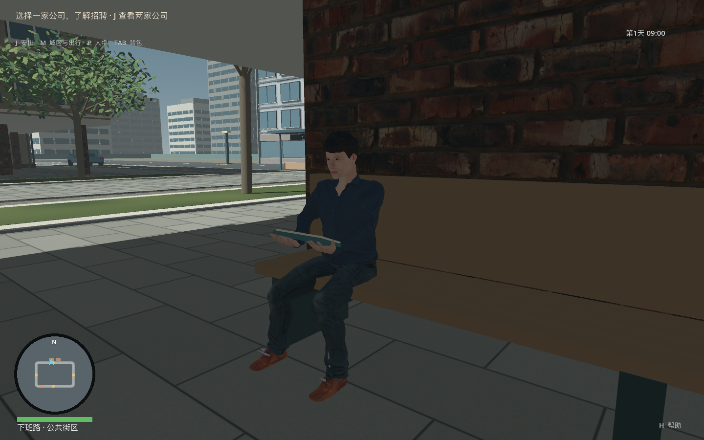
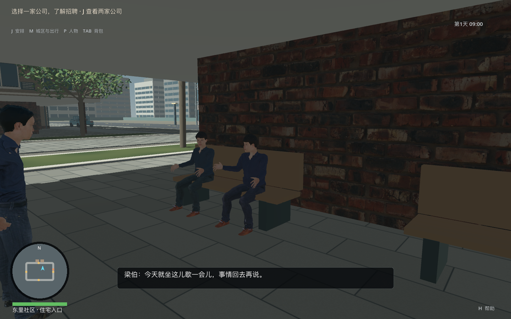
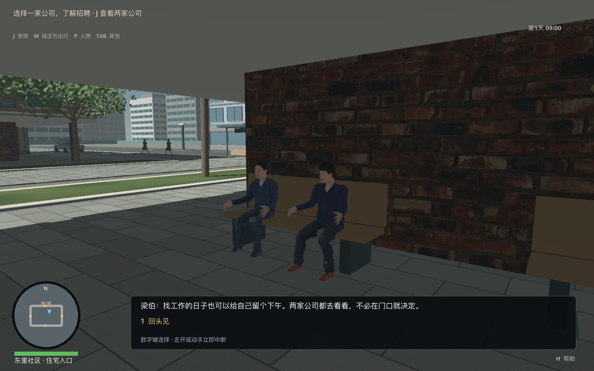
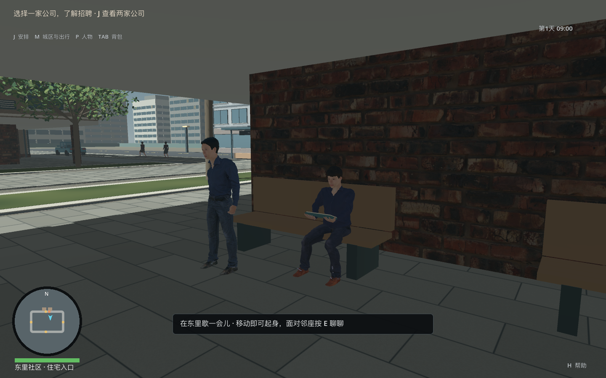

# 公共连廊日常生活取证

日期：2026-09-29。基线 ff9eca1。八张最终源码生活图来自 `tools/render_city_commons.gd` 实际渲染；三张 route 图来自本阶段后台 A/B 职业完整路线。两张 early-transition 为第一轮冻结过早、朝向尚未完成时的反例。十三张归档图片均已实际查看。

居民从初始地点实际走到长凳，拍摄者用独立固定相机取景；玩家在图形夹具里从场所前方加入。真实玩家步行与 E 输入另由 `tests/city_commons_test.gd` 验证。不是独立玩家自然游玩录像，也不是正式视听验收。

1440×900 子视口、55°；最小化且不可聚焦的主窗口，root_focused=false、pointer_visible=true。落座过渡后再冻结取图；居民转身与坐姿不能用“seated 已真”的第一帧当最终姿态。详见 render.json，图片摘要见 image-sha256.json。

最终八张生活图与独立包同运行源码c10075be；包含玩家落座、共同交谈及起身。三张route图的源码边界与最终全套覆盖见verification.json。图片证明局部姿态和场景状态，不证明自然坐下/起身、取放/翻页已达到正式动画品质。

图像仍可见居民外观复用、简化家具/墙面、偏暗的廊下空间与缺少正式对白表演。这些不因占用、碰撞和骨骼接触测试通过而关闭。

