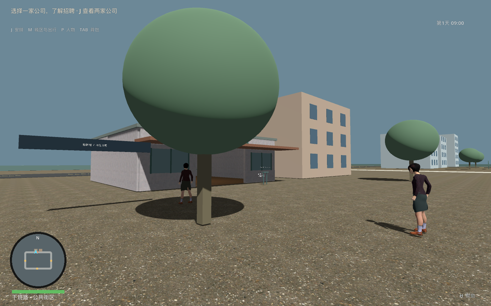
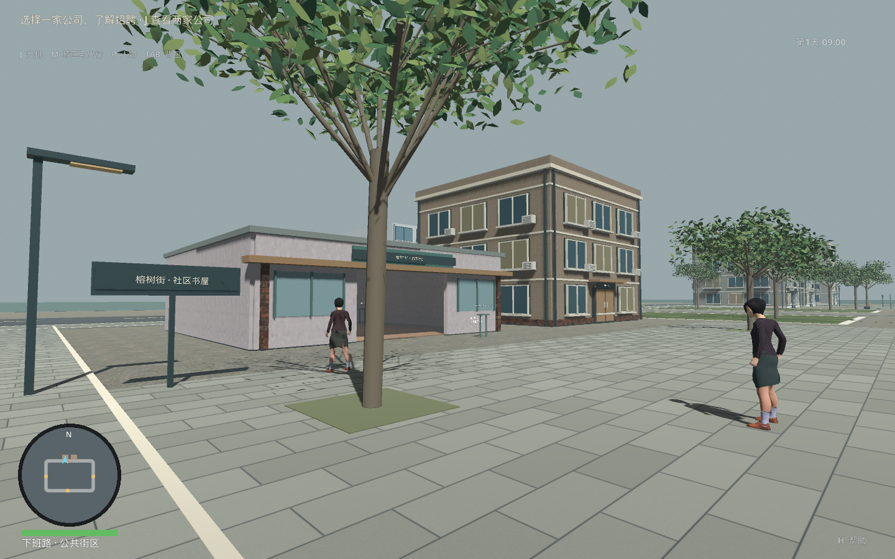
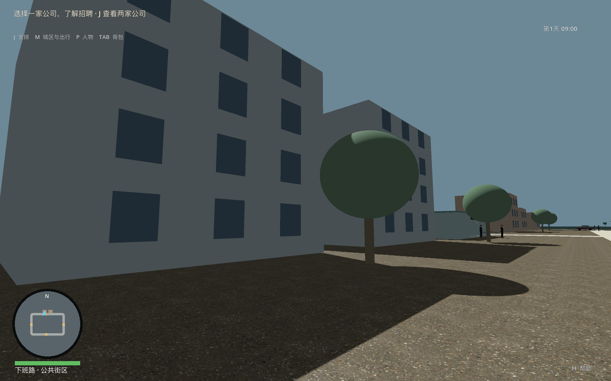
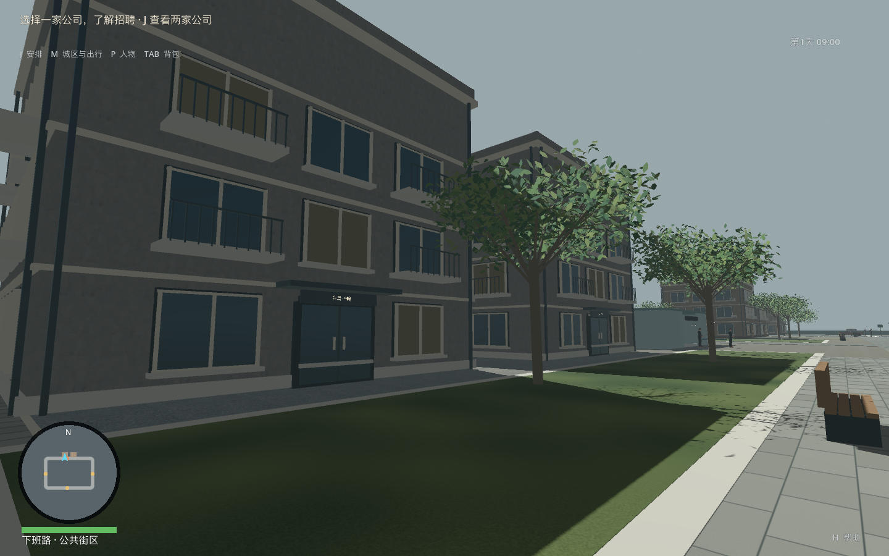
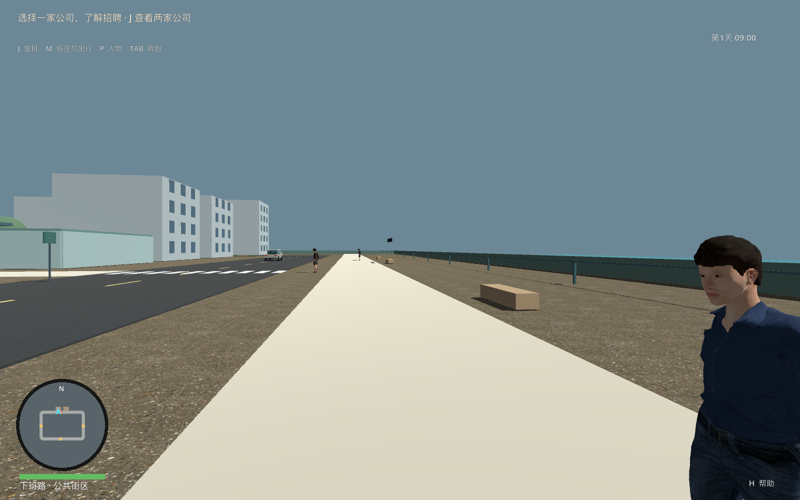
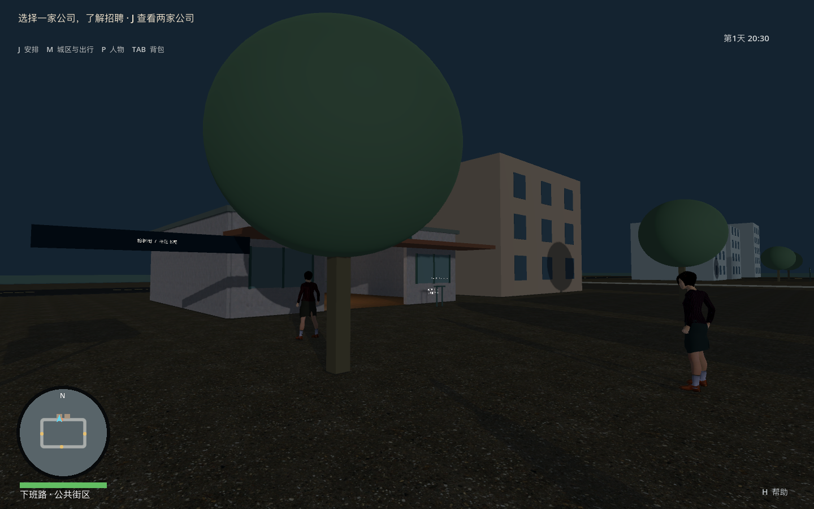
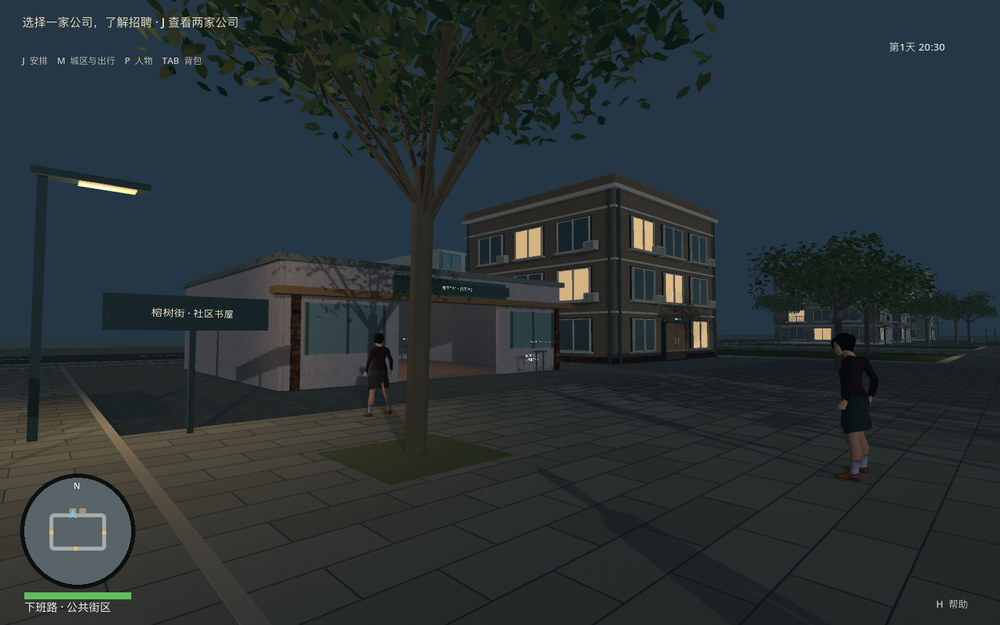

# 首区街景与空间层次取证

日期：2026-09-29。修改前运行基线 dd7abea；修改后身份以本目录构建清单和验收记录为准。

before/after 各八张同位图：old-street、bookshop、homes、waterfront、company-exit、district-overview、old-street-night、waterfront-night。前后 16 张均逐张查看；另存两张实际查看的迭代反例：棱角树叶/碎石地表、砖缝远距点状混叠。

前后保持 1440×900、65°视角、相同相机位置/目标/09:00或20:30。场景载入后冻结过程，使用取证相机，不是玩家实走录像；HUD地点仍来自玩家出生位置。天空与雾属于本次实际修改。窗口实测最小化、不可聚焦、无焦点、鼠标可见；不能称作隐藏窗口。

after-render.json / before-render.json 记录可见绘制调用与图元，不是普通游玩的 FPS 或 GPU 耗时。新增几何确实增加图元；没有把批处理说成免费提升。

## 观察

- 老城/住宅补齐四面立面、楼层、窗框、门厅、雨棚、设备与栏杆，仍存在模块重复、无真实室内的窗面和较硬边缘。
- 球冠替换为分叉树干/叶片，树种变化、叶面透光、风动、枝叶连接和正式植被 LOD 仍待制作。
- 公共步道、广场、草地、书屋入口及滨水栏杆/座椅有可辨层次。初版细砖缝在远处变成点线，像素导数平滑后静态图改善；移动镜头时序稳定性仍待正式录验。
- 夜间有实际街灯照明与部分住户窗光；不代表整城灯光、声音、天气已完成。
- 仅首区环境子阶段，未达到 GTA VI 展示水准或完成 30—60 分钟自由游玩验收。

## 同位对照

| 修改前 | 修改后 |
| --- | --- |
|  |  |
|  |  |
|  |  |
|  |  |

几何确定性另外由真实图形后端读取两次新建场景的非空 MultiMesh 变换比较；无窗口后端的空数组比较已撤回。该过程重置夹具新增输入动作，避免重复注册。

SHA-256 见 image-sha256.json。问题表与实际测试结果见 [C4a 验收](../../2026-09-29_C4a首区街景与空间层次验收.md)。
