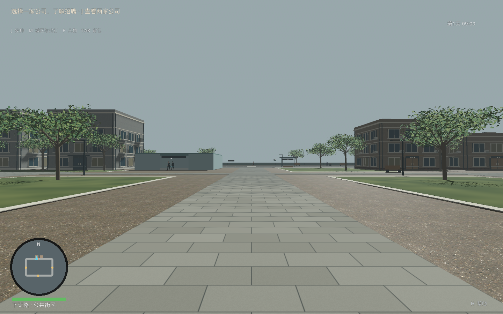
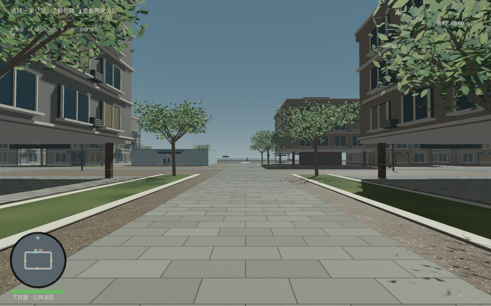
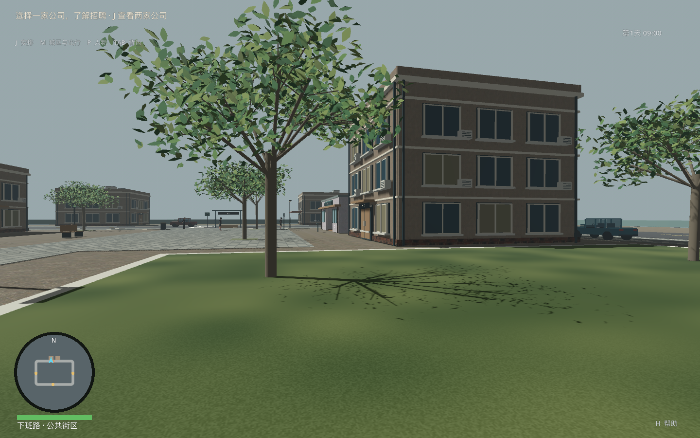
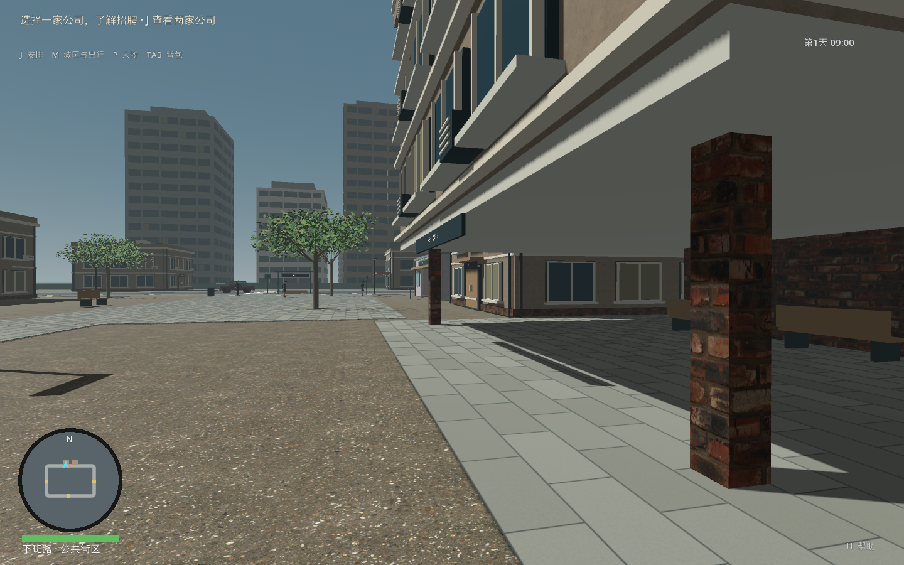
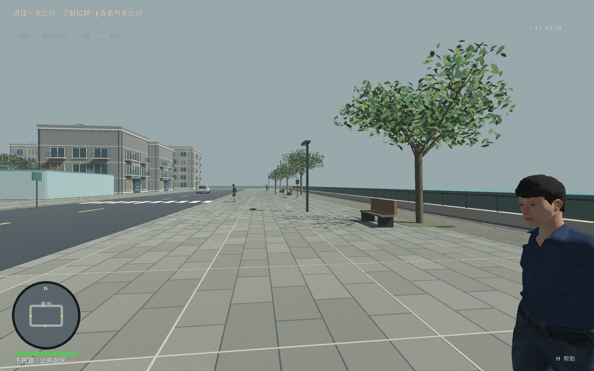
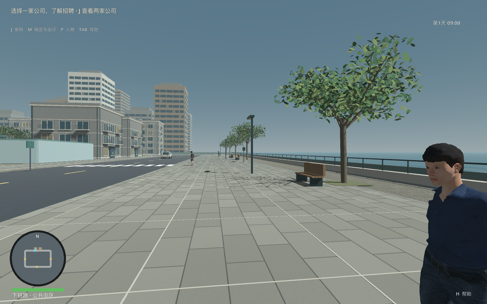
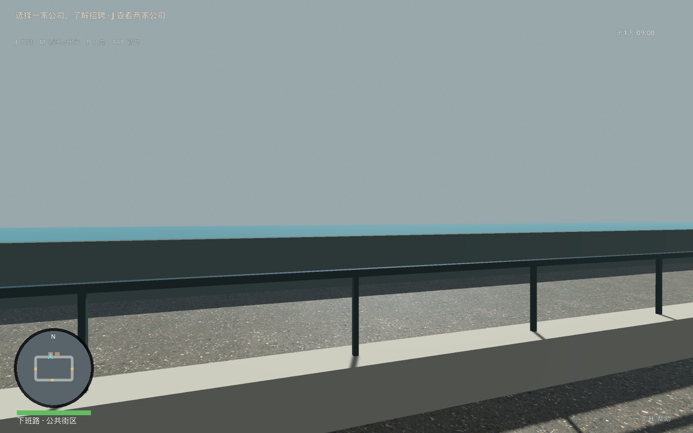
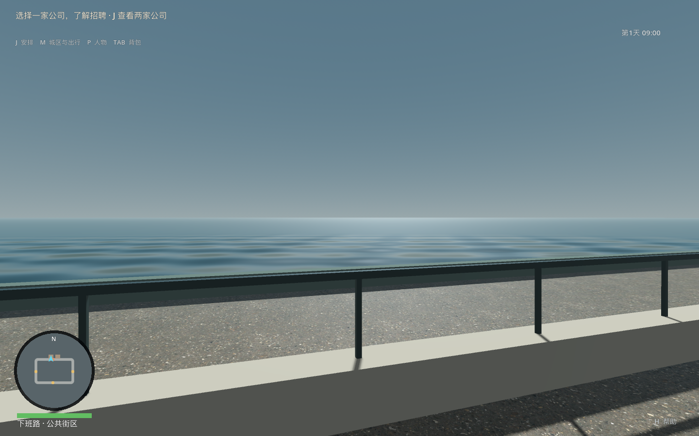

# 中心街廊与城市背景取证

日期：2026-09-29。修改前运行基线e6bc4f7（运行摘要ecae33c4）；最终身份以本目录构建清单及[C4c验收](../../2026-09-29_C4c中心街廊与城市背景验收.md)为准。

before/after各11个同位视角：老城、书屋、住宅、滨水、公司出口、俯瞰、老城/滨水夜景、中心步道、廊道、海面。最终另含sea-wave-shift，固定场景只改变海面波相0→2秒，真实图片949312/5184000字节改变。此项证明着色器有真实像素输出，不是自然游玩录像或声音验收。

全部同位图及两个灰天/遮海反例已实际查看。最终前10图与已看候选逐字节相同；海面两图另行查看。route三图来自本次后台A/B职业及拒绝/协商完整路线。图片SHA-256见image-sha256.json。

工具：tools/render_city_urban.gd继承既有最小化/不可聚焦子视口工具。1440×900、65°、09:00或20:30；固定取证相机、冻结世界，HUD地区仍由玩家初始位置决定。不是玩家自然摄影，也不将调用数转换为普通FPS。before-render.json和final-render.json记录相机、实际调用/图元、窗口/鼠标守卫及真实非空GPU变换重建。

## 可见变化与未完成

- 三处带可穿行底层的建筑围合中心步道，调整原草地/树位；原书屋、社区花园、公司和通行道路保持。
- 29处外围楼体只提供城市背景，没有新交通、室内、NPC或保存身份，不计入可玩面积或64km²目标完成量。
- 原天空被雾色覆盖；降低天空受雾比例后恢复渐变。第二道海边围墙降低后能在栏杆上方看到连续水面。
- 高层立面仍重复，近景材料/植被仍简化，场所活动密度未随背景增加。未达到正式写实美术或完整30—60分钟城区品质。
- GPU批次305→563，新增几何有明确成本；冻结场景的调用/图元不是最终性能签收。

## 对照

| 修改前 | 修改后 |
| --- | --- |
|  |  |
|  |  |
|  |  |
|  |  |
