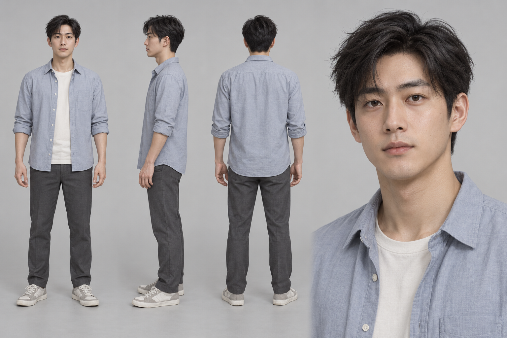

# CH2-V1 男性主角二维视觉样板

2026-10-01，使用内置 imagegen 新生成。此图用于讨论造型，是二维概念参考，不是 MetaHuman 输出、游戏截图或可动三维模型。用户已选择的方向是：先男性、普通清爽求职者、玩家化身、校园刚毕业。

- [完整提示词](prompt.md)
- [图像尺寸、摘要和观察记录](manifest.json)
- [设计与后续制作计划](../../2026-10-01_男性主角视觉样板与制作计划.md)

## 实际观察

四视图已直接查看：全身正/侧/背均包含头顶与完整鞋子；蓝灰敞开衬衫、轻挽袖口、米白内搭、深灰直筒裤、浅色运动鞋符合配色与轮廓；脸、黑色短发和衣装在图片层面保持可辨身份。肩颈与站姿放松，未见明显肢体尖片或多余肢体。背面部分手指被自然遮挡，不声称每视图五指均完整可数。

用户2026-10-01明确回复“可以，就先用这个吧”，已确认采用此版作为默认男性造型参考。三维拓扑、UV、骨骼、材质、走跑坐、眨眼与游戏运行均未由本图证明，CH1-B/C/D保持开放。
